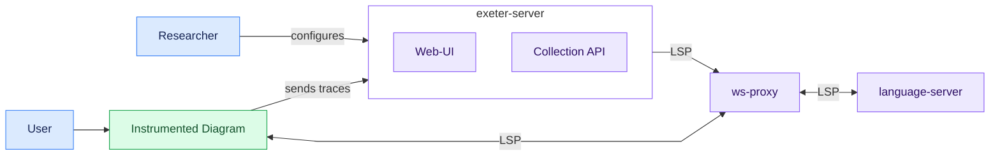

# Exeter

Exeter is an application that supports you with conducting interactive diagram studies by providing tools to:

- Configure models and stimuli for experiments,
- embed instrumented diagrams into survey environments,
- collect interaction traces.

## Applications

Exeter is built from a few connected components, all of which are located inside `apps/`.

- `exeter-server` contains the Collection Server API and Web-UI,
- `language-server` is just a slim Java runtime around the `language-server.jar` from KIELER,
- `ws-proxy` is a small Node server which accepts connections via WebSocket and forwards them to the language server.

## Deployment

The source code inside `apps/` is built into Docker images via GitHub actions.
Copy `docker-compose.yml` and `.env.example` to your deployment directory.
If you don't already have an `.env.local` there, run `cp .env.example .env.local`.

Use `.env.example` as a checklist for any existing `.env.local`.
Replace the placeholder credentials and example domains before starting, and keep `.env.local` private.

Configure a host reverse proxy to terminate HTTPS and:

- forward app traffic to `127.0.0.1:3000`,
- forward `/socket` with WebSocket upgrades to `127.0.0.1:8000`.

Start the stack from the deployment directory using `docker compose up`.

PostgreSQL data and uploaded model source files live in a `./data/` directory.
